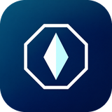

<h1>Shad Josef</h1>

  <strong>BSc in Data Science for Business · BI Norwegian Business School (Oslo, Norway)</strong> 
  Building local-first study systems, financial analysis tools, and reproducible Python/TypeScript software.

  
  
  

---

### Selected Projects

<table>
  <tr>
    <td width="92" align="center">
      
    </td>
    <td>
      <a href="https://github.com/shadjosef/study-os"><strong>Study-OS</strong></a> · <a href="https://studyos.no/"><code>studyos.no</code></a> 
      <code>Zero-dep JS &amp; Python</code> · <code>Cloudflare Workers + EU D1</code> · <code>Chrome MV3</code> · <code>VS Code</code> · <code>MCP</code> · <code>94+ automated tests</code> 
      Local-first university exam &amp; study workbench for BI Oslo and 13+ Norwegian universities — verified past-exam exercises, instant accounting worksheet grading, AI-Par timer, FSRS-5 spaced repetition, TimeEdit calendar sync, and a hardened EU edge backend running near <code>$0/mo</code>.
    </td>
  </tr>
  <tr>
    <td width="92" align="center">
      
    </td>
    <td>
      <a href="https://github.com/shadjosef/Northlink"><strong>Northlink</strong></a> 
      <code>Python 3.14</code> · <code>Streamlit</code> · <code>SQLite</code> · <code>Kartverket / MET Norway</code> · <code>89 pytest checks</code> 
      Offline geospatial evidence and human-review continuity prototype built for the <strong>EUDIS Norway Hackathon</strong>. Combines prepared Kartverket topography and recorded MET weather geometry with SHA-256 intake verification, append-only review reopening, and deterministic JSON/Markdown handovers.
    </td>
  </tr>
  <tr>
    <td width="92" align="center">
      
    </td>
    <td>
      <a href="https://github.com/shadjosef/canvas-study-sync"><strong>Canvas Study Sync</strong></a> 
      <code>Python 3.11+</code> · <code>macOS &amp; Windows</code> · <code>OS Keychain</code> · <code>225 unit tests</code> · <code>CodeQL</code> 
      Local-first course archive and citation-indexed study-pack pipeline. Parses PDFs, slide decks, Word documents, spreadsheets, Jupyter notebooks, and Ed Discussion threads into searchable Markdown packs with page/cell provenance and zero AI uploads.
    </td>
  </tr>
</table>

---

### Focus Areas

- **Local-First Systems & EdTech Engineering:** Zero-dependency PWAs, offline IndexedDB vaults, FSRS-5 spaced-repetition scheduling, EU-resident edge backends, and verifiable privacy-first telemetry.
- **Valuation & Cash-Flow Scenario Modelling:** Decomposing direct asset exposure versus cross-denominated cash-flow vehicles across daily revenue and relative-price regimes.
- **Derivatives Market Structure:** Perpetual-futures mechanics, exchange fee capture vs. notional volume, open interest, and 24/7 clearing/margin design.
- **Secondary-Market Pricing & Probabilistic Games:** Secondary-market sourcing, pricing, and resale across online marketplaces (`USD 10,000+` cumulative sales) alongside **Top 500** competitive play in Overwatch.
